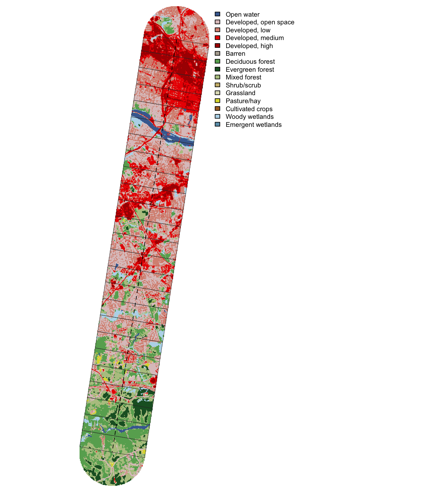
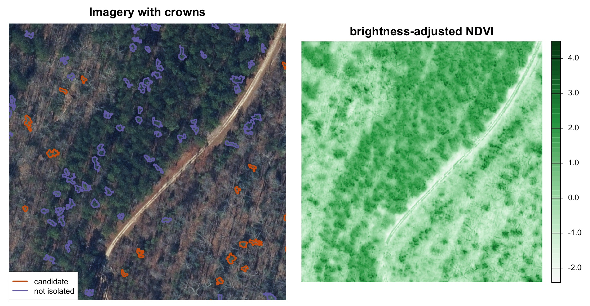
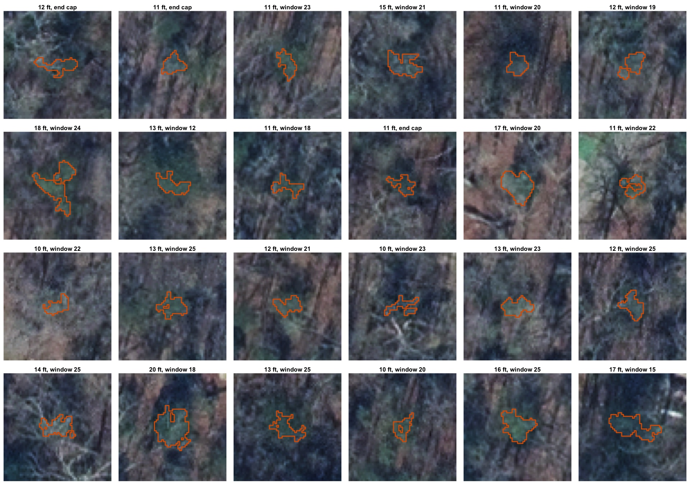
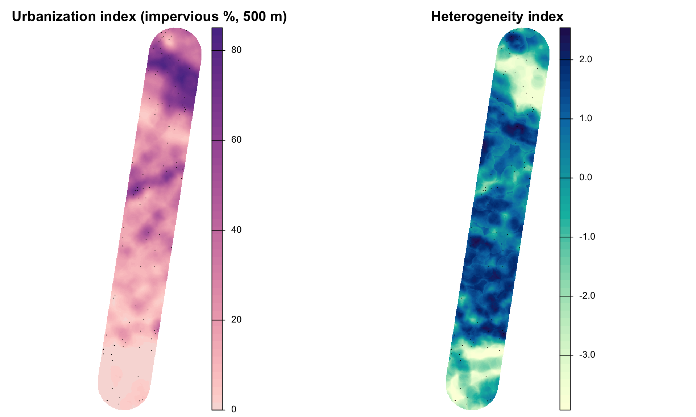

<!--
GHOST NOTES
- Paste everything below this comment into a Markdown card (or use Ghost's Markdown import).
- Relative image paths (media/...) won't resolve in Ghost. Upload each file in blog/media/
  and replace the path, or swap each image line for a Ghost image card with the caption below it.
- Fill in the three [email] placeholders in "How to get involved" before publishing.
- Set the feature image to media/header-leaf-off.jpg (or media/licensed-to-ilex.jpeg if you prefer the project art).
-->

In winter, most of the forest around Richmond loses its leaves. American holly (*Ilex opaca*) keeps its leaves. From the air, every holly in the understory shows up as a small green patch against bare branches, and that difference is where this project begins.

We are starting a new research project on how American holly and the insects that pollinate it, feed on it, and parasitize those feeders change along a **25-km gradient from industrial Richmond to Pocahontas State Park**. We are recruiting undergraduates **this winter** to join as a cohort across three areas: **geospatial analysis and reproductive ecology**, **plant–insect ecology**, and **evolutionary genetics**. Students earn research credit and get hands-on research experience, and the project is designed to grow into a larger, multi-city study.

## The question

Cities change the places plants and insects live. They pave over ground, break forest into fragments, raise temperatures, and fill yards with nursery plants. Most studies compare "urban" sites with "rural" ones. We think that comparison misses a lot. Different processes may change at different points along the way from downtown to forest: seed production might drop in one place, while herbivory or leaf chemistry shifts somewhere else.

So we treat urbanization as a **continuous gradient** and ask *where* along it things change.

Holly works well for this question. It is a native understory tree that does well in both forests and suburban yards, one of the Anthropocene's "winners." It also comes with a small, well-defined community of insects:

- **Pollinators.** Holly is *dioecious* (individual trees are either male or female), so a female tree sets seed only if insects carry pollen to it from a male. The nursery trade mostly sells grafted female clones, so urban holly populations may be female-biased and short on pollen.
- **A specialist herbivore.** The native holly leaf miner (*Phytomyza ilicicola*) is a small fly whose larvae tunnel inside holly leaves.
- **Parasitoids.** Tiny wasps that attack the leaf miner larvae, adding a third level to the food web.

## What we've done so far

Before anyone goes into the field, we used geospatial analysis to lay out the study.

*The study area: a 25-km transect, 4 km wide, from industrial Richmond (top) to Pocahontas State Park (bottom), divided into 1-km windows and colored by NLCD land cover. Red is developed land; green is forest.*

**Defining the gradient.** We split the corridor into twenty-five 1-km windows and summarized land cover and impervious surface in each from the National Land Cover Database. That turns "urban to rural" into numbers we can measure.

**Finding holly from the air.** The 2025 Virginia Base Mapping Program imagery was flown in February and March, while deciduous trees were bare, at a resolution of 1 foot per pixel, and it includes a near-infrared band. Living leaves reflect near-infrared light strongly. Using a vegetation index (NDVI) adjusted for shadows, we can pick out evergreen crowns in a leaf-off canopy.

*Left: leaf-off imagery 22.5 km along the transect, with a pine stand in the upper left and bare hardwoods in the lower right. Orange outlines are holly candidates: small, isolated evergreen crowns in the hardwood understory. Right: the same area in brightness-adjusted NDVI.*

Across the study area, the workflow found **268,025 evergreen crowns** and narrowed them to **12,814 holly candidates** based on crown size and isolation.

*A sample of candidate crowns. Each is 10–20 ft across. We think most are holly, but we won't know until someone visits them.*

**Picking focal trees.** From the candidates, we selected **100 focal trees** spread evenly across the urbanization gradient and across different kinds of surrounding landscape. No two trees are within 100 m of each other, which reduces the chance of sampling close relatives. Each focal tree also has ranked alternates nearby.

*Each focal tree is described by its surroundings within 500 m: how much impervious surface there is (left) and how mixed the land cover is (right). Dots are focal trees and alternates.*

Every step is documented with code and interactive maps on the project site: **[dyerlab.github.io/Licensed_to_Ilex](https://dyerlab.github.io/Licensed_to_Ilex/)**.

What's missing is **ground truth**. Some of these "holly" crowns are actually magnolia, cedar, boxwood, or other evergreens, especially in town. Someone has to go find out which ones are real.

## Three areas, one cohort

We are recruiting students into three connected areas. Each area has its own faculty mentor, and all of the students work together as a single cohort: shared field days, shared data, and regular meetings across the three labs. A geospatial student will learn what a parasitoid is, and an ecology student will learn how a map gets made.

### 1. Geospatial analysis and reproductive ecology
**Mentor: Dr. Rodney Dyer**

This area is a strong fit for students in **Cartography, GIS, or Environmental Studies**. You will connect the maps to what is actually on the ground:

- **Ground-truth the imagery.** Navigate to focal trees and candidates with GPS, confirm whether each is holly, record its sex, size, and condition, and note what the false positives turn out to be.
- **Build a better classifier.** Use those field labels to train a supervised classification model on crown features (NDVI, near-infrared, size, shape, and context), then map holly across the whole transect.
- **Map reproduction.** Collect seed from female trees and track seed set, seed viability, abortion, and germination. Then put those measurements on the map: does seed production change with impervious surface, fragmentation, distance to the nearest male, or forest edge?
- **Sex ratios and pollination.** Test whether urban holly is female-biased, and help run spring pollinator surveys at mapped trees.
- **Make the maps.** Turn the results into publication-quality figures and help build the spatial data layers that the whole team relies on.

**Skills you'll build:** field GPS data collection, remote sensing with multispectral imagery, landscape metrics, supervised classification, spatial statistics, reproducible workflows in R or QGIS, and cartographic design for scientific publication.

### 2. Plant–insect interactions: herbivory and parasitism
**Mentor: Dr. Salvatore Agosta**

This area suits students interested in **ecology, entomology, or field biology**. You'll study how holly's interactions with insects shift along the gradient:

- Photograph leaves on focal trees to measure herbivory, both this year's damage and damage from previous years.
- Find and rear holly leaf miner larvae to measure their survival and identify the parasitoids that emerge.
- Measure leaf traits that affect herbivores, such as toughness, thickness, and water content.
- Deploy temperature and humidity loggers to measure microclimate at each tree.

**Skills you'll build:** insect rearing and identification, field sampling design, image-based measurement, microclimate monitoring, and ecological data analysis.

### 3. Evolutionary genetics: reciprocal common gardens
**Mentor: Dr. Andrew Eckert**

This area suits students interested in **evolution, genetics, or plant biology**. Do urban and forest holly differ because of their environments, or because of their genes? To find out, we'll grow seedlings from about 100 mother trees in **reciprocal common gardens**, one at an urban site and one at a forest site, and compare early fitness traits such as germination, survival, and growth.

- Help establish and maintain the common gardens with seeds collected this winter.
- Measure germination and early seedling performance.
- Contribute to chloroplast DNA work that asks whether nursery cultivars have mixed into wild holly populations.

**Skills you'll build:** experimental design, plant propagation, quantitative genetics, and molecular lab methods.

## Timing: why this winter

Holly fruit ripens in late fall and stays on the tree into winter. **We need to collect seed from the focal trees before the end of the year or early next semester**, while the fruit is still there. Those seeds go into germination trials and the common gardens, so a missed season can't be made up later. Winter is also when trees are easiest to find, and when female trees are easiest to identify by their red berries.

| When | What's happening |
|---|---|
| **Winter** (now through February) | Ground-truth candidates; map and sex trees; collect seed; photograph leaves for herbivory; collect leaf tissue for DNA |
| **Spring** (April–June) | Pollinator surveys; leaf-miner rearing and parasitoids; leaf traits; microclimate loggers; DNA work |
| **Summer and beyond** | Germination trials; common-garden establishment and monitoring; analysis and mapping |

## What you get

- **Course credit** through independent study or the zero-credit research course.
- **Real research experience** on a new project, with the chance to develop your own question within it.
- **Field skills and portfolio pieces.** For GIS students, a ground-truthed classification and a set of finished maps are concrete things to show employers or graduate programs.
- **A cohort and three mentors** from different fields.
- **A role in what comes next.** Richmond is the pilot for a planned NSF proposal to replicate this gradient in other southeastern cities, and students who start now help lay the foundation.

You don't need prior research experience. For the geospatial area, coursework in cartography or GIS is helpful. For all three areas, we're looking for curiosity, reliability, and a willingness to spend time outdoors in winter.

## How to get involved

Email the faculty mentor for the area that interests you most. Include a few sentences about your major, relevant courses, and why the project interests you. If you aren't sure which area fits, write to any of us and we'll help you figure it out.

- **Geospatial analysis and reproductive ecology:** Dr. Rodney Dyer, [email]
- **Herbivory and parasitism:** Dr. Salvatore Agosta, [email]
- **Common gardens and evolutionary genetics:** Dr. Andrew Eckert, [email]

Because seed collection can't wait, **please reach out as soon as possible**.

*This project is a collaboration among the Agosta, Eckert, and Dyer labs in the School of Life Sciences and Sustainability at VCU, with field sites from the City of Richmond to Pocahontas State Park and experimental facilities at the VCU Rice Rivers Center.*
