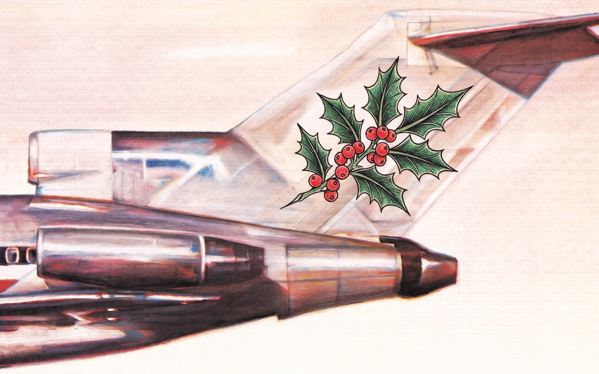

<i>Because we can, we will, and we won't stop...</i>

```{=html}
<video class="hero" muted playsinline controls preload="metadata"
       poster="media/licensed_to_Ilex.jpeg" aria-label="Licensed to Ilex">
  <source src="media/licensed_to_Ilex.mp4" type="video/mp4">
  
</video>
<style>
  video.hero { width: 100%; height: auto; border-radius: 6px; margin-bottom: 1.5rem; }
</style>
<script>
  // Play once, on the first visit only (remembered in this browser). Later visits, and
  // viewers with reduced motion turned on, see the still image; the play button still works.
  (function () {
    const v = document.querySelector("video.hero");
    const key = "ilex-hero-played";
    let played = false;
    try { played = localStorage.getItem(key) === "1"; } catch (e) {}
    if (played || window.matchMedia("(prefers-reduced-motion: reduce)").matches) return;
    v.play().then(function () {
      try { localStorage.setItem(key, "1"); } catch (e) {}
    }).catch(function () {});   // autoplay blocked: leave the still image
  })();
</script>
```


> Human activity is reshaping landscapes, and with them the plant and insect communities that live there. This project uses American holly (Ilex opaca), a common understory tree that thrives in both forests and cities, to ask how plants and their associated insects respond along a continuous gradient of urbanization, from highly managed urban sites in Richmond to secondary-growth forest. Rather than treating “urban” and “rural” as two categories, we are looking for where along the gradient key changes happen: shifts in sex ratios, mating patterns, pollinator communities, herbivory by the holly leaf miner and its parasitoids, leaf traits and physiology, and seed production. The work combines geospatial mapping, field surveys, greenhouse germination, common gardens, and potentially genetic analyses, with the goal of understanding how to manage human-modified landscapes to reduce their impacts.


This site documents spatial analyses components of this project using the 2025 Virginia Base Mapping Program (VBMP) 12-inch orthoimagery along a 25 km transect from industrial Richmond, Virginia (37.584817° N, 77.472433° W) to Pocahontas State Park (37.373768° N, 77.570813° W), buffered by 2 km on each side.  The overall goal here is to identify smampling zones, target trees, and establish a set of individuals along the gradient to serve as focal trees along a mulitfaceted gradient from highly developed Richmond Virginia $\to$ Pochontas State Park.

## Analyses

| | Analysis | Description |
|---|---|---|
| 01 | [Study area and orthoimagery](analyses/01_study_area.qmd) | Transect, study area, imagery tiles, and mosaic |
| 02 | [Urban to forest gradient](analyses/02_gradient.qmd) | Annual NLCD land cover, impervious surface, and leaf-off NDVI in 1 km windows along the transect |
| 03 | [Holly candidates](analyses/03_holly_classification.qmd) | Small, isolated evergreen crowns in leaf-off NDVI as candidate holly locations for ground truth |


## Framing 

- Urbanization is treated as a continuous gradient, not an urban-versus-rural comparison. The goal is to identify “phase shifts” from urban to peri-urban to secondary forest, with applied value for managing human-modified landscapes.
- It builds directly on the dogwood work: about 60 maternal trees sampled from Richmond to Pocahontas State Park, with mating system parameters analyzed against spatial, impervious surface, and land cover gradients.
- Holly is framed as an Anthropocene “winner,” like pigeons and rats, a species doing well in human landscapes that’s worth understanding for that reason.

## Questions

1. Sex ratios: Holly is dioecious, and the nursery trade sells grafted female clones. Urban areas may be female-biased, which could lower seed set through limited pollen.
2. Pollination: Little is known about who pollinates holly. The visitors appear to be mostly generalists. One hypothesis is that non-native urban pollinators compensate, so there’s no net effect on seed set.
3. Herbivory: The holly leaf miner and its parasitoids, including possible co-evolution along the gradient.
4. Leaf traits and physiology: Leaf toughness, LI-COR gas exchange, and water-use efficiency, linked to herbivore performance (modeled on the Costa Rica caterpillar study).
5. Fragmentation: Holly often grows on forest edges, so edge versus interior is a related axis.
6. Longer term: Reciprocal common gardens (Rice Rivers Center and an urban site near the Science Museum), and range-wide phylogeography, including high-elevation Appalachian populations.

## Approach 

- Start with low-cost observational data: 
  - Map and sex trees after leaf drop, 
  - Collect seeds from mother trees through December (freezer storage), 
  - Photograph leaves on target trees for herbivory, 
  - Rear leaf miners for parasitoids, 
  - Run pollinator counts in April–June.
  - Germination tests, seed abortion, etc. ~ (landscape location).


## People 

- Recruit undergraduates by pitching to targeted courses: GIS/cartography for spatial work, ecology for herbivory & pollinators, and evolution for co-evolution.
- Formats include independent study, the new zero-credit research course, and a possible fall capstone or seminar that produces the literature review.
- An NSF submission is planned.

